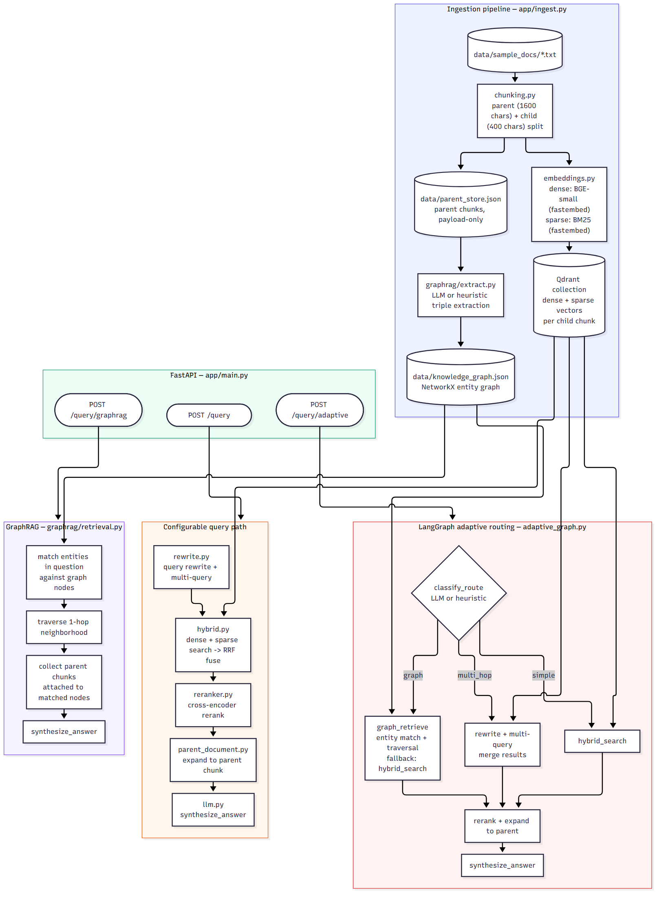

# Advanced RAG over Qdrant

A hands-on reference implementation of the **Advanced RAG Implementation Checklist** —
every item built as real, runnable code against [Qdrant](https://qdrant.tech/) and
[FastAPI](https://fastapi.tiangolo.com/), with [LangGraph](https://www.langchain.com/langgraph)
adaptive routing and a lightweight [GraphRAG](https://microsoft.github.io/graphrag/) module.

## Checklist coverage

| # | Item | Estimate | Where it lives |
|---|------|----------|-----------------|
| 1 | Basic RAG with FastAPI + Qdrant | 2–3h | `app/main.py`, `app/ingest.py`, `app/qdrant_store.py` |
| 2 | Hybrid search + RRF | 1–2h | `app/retrieval/hybrid.py`, `app/rrf.py` |
| 3 | Query rewriting + multi-query | 1–2h | `app/retrieval/rewrite.py` |
| 4 | Cross-encoder reranker | 1h | `app/retrieval/reranker.py` |
| 5 | Parent-document retrieval | 1h | `app/retrieval/parent_document.py`, `app/chunking.py` |
| 6 | RAGAS evaluation dataset (50 Qs) | 2–3h | `eval/build_dataset.py`, `eval/questions.json`, `eval/run_ragas.py` |
| 7 | Adaptive retrieval with LangGraph | 2–3h | `app/retrieval/adaptive_graph.py` |
| 8 | GraphRAG / multimodal retrieval | 3–4h | `app/graphrag/extract.py`, `app/graphrag/retrieval.py` |

## Architecture



*(Mermaid source: [`docs/architecture.mmd`](docs/architecture.mmd))*
```

## Quickstart

```powershell
# 1. Start Qdrant
docker compose up -d

# 2. Install deps
python -m venv .venv
.\.venv\Scripts\activate
pip install -r requirements.txt

# 3. Configure (optional, but required for query rewriting/multi-query/
#    GraphRAG extraction/answer synthesis — retrieval works without it)
copy .env.example .env
# edit .env and set OPENAI_API_KEY

# 4. Ingest the sample docs (swap data/sample_docs for your own corpus)
python -m app.ingest --recreate

# 5. (Optional) build the GraphRAG knowledge graph
python -m app.graphrag.extract

# 6. Run the API
uvicorn app.main:app --reload
```

Then try it:

```bash
curl -X POST http://localhost:8000/query -H "Content-Type: application/json" \
  -d '{"question": "How are Northwind Robotics and Cascade Logistics connected?"}'

curl -X POST http://localhost:8000/query/adaptive -H "Content-Type: application/json" \
  -d '{"question": "Compare the Sentinel-1 and Sentinel-2 battery life"}'

curl -X POST http://localhost:8000/query/graphrag -H "Content-Type: application/json" \
  -d '{"question": "How is Highline Ventures related to Cascade Logistics?"}'
```

Interactive docs: `http://localhost:8000/docs`.

## Real example (actual output, no LLM key configured)

This is unedited output from a real local run — Qdrant in Docker, sample
corpus ingested, no `OPENAI_API_KEY` set (so answer synthesis falls back to
extractive context instead of an LLM-written summary; retrieval itself is
fully live).

**`POST /query/adaptive`** with `{"question": "Compare the Sentinel-1 and Sentinel-2 battery life"}`:

```json
{
  "question": "Compare the Sentinel-1 and Sentinel-2 battery life",
  "route": "multi_hop",
  "trace": [
    "classified as 'multi_hop'",
    "multi_query x2",
    "reranked + expanded to parents",
    "answer synthesized"
  ],
  "retrieved": [
    {
      "source": "product_lineup.txt",
      "rank_method": "multi_hop",
      "score": 7.158,
      "text": "The Sentinel-1 is Northwind Robotics' first commercial product... a single battery charge lasts approximately 8 hours. The Sentinel-2... doubles the battery life to roughly 16 hours per charge..."
    },
    {
      "source": "company_overview.txt",
      "rank_method": "multi_hop",
      "score": 1.987,
      "text": "Northwind Robotics was founded in 2017 by Elena Vasquez and Marcus Chen..."
    }
  ]
}
```

The LangGraph classifier correctly routed this comparison question to the
`multi_hop` strategy (query rewrite + 2 generated sub-queries, merged before
reranking), and the cross-encoder reranker correctly ranked the chunk
containing both battery figures above the general company-overview chunk.

**`POST /query/graphrag`** with `{"question": "How is Highline Ventures related to Cascade Logistics?"}`:

```json
{
  "retrieved": [
    {"source": "partners_and_customers.txt", "rank_method": "graph", "score": 8.0},
    {"source": "product_lineup.txt", "rank_method": "graph", "score": 11.0},
    {"source": "company_overview.txt", "rank_method": "graph", "score": 2.0}
  ]
}
```

Graph traversal matched the entities "Highline Ventures" and "Cascade
Logistics" in the extracted knowledge graph (30 nodes / 75 edges from the
4-document demo corpus) and pulled every parent chunk reachable within one
hop — correctly surfacing the `partners_and_customers.txt` chunk describing
Cascade Logistics' role as both customer and Series B co-investor alongside
Highline Ventures.

Set `OPENAI_API_KEY` in `.env` to get full LLM-written, citation-backed
answers instead of the extractive fallback shown above — the retrieval and
ranking logic is identical either way.

## Evaluation

```bash
python -m eval.run_ragas --mode hybrid_rerank_parent
python -m eval.run_ragas --mode adaptive
```

Scores each of the 50 questions in `eval/questions.json` (tagged `simple` /
`multi_hop` / `graph`) with RAGAS `faithfulness`, `answer_relevancy`,
`context_precision`, and `context_recall`, and writes per-question results to
`eval/results/<mode>.json`. Run multiple `--mode`s to compare retrieval
strategies head-to-head.

## Tests

```bash
pytest -q
```

`tests/test_smoke.py` covers the pure-logic parts (chunking, RRF math,
heuristic query routing, heuristic entity extraction) without requiring a
running Qdrant instance or an API key — this is also what CI runs
(`.github/workflows/ci.yml`).

## Design notes

- **Offline-friendly by default**: dense + sparse embeddings run locally via
  `fastembed` (no API key needed). LLM-powered features (query rewriting,
  multi-query, GraphRAG extraction, adaptive-route classification, final
  answer synthesis) gracefully fall back to heuristics or extractive answers
  when `OPENAI_API_KEY` isn't set, so the whole pipeline is runnable without
  any paid API.
- **Deterministic point IDs**: child chunk IDs are hashed with `uuid5` so
  re-running ingestion on the same corpus upserts in place instead of
  duplicating points.
- **Two-level chunking**: every document is split into large "parent" chunks
  (stored, not vectorized) and small "child" chunks (vectorized for
  precision). Parent-document retrieval, GraphRAG extraction, and the
  adaptive pipeline's context expansion all operate on the parent store.
- **Swap the LLM provider** via `OPENAI_BASE_URL` in `.env` — works with any
  OpenAI-compatible endpoint (Azure OpenAI, local vLLM, etc.).

## Project structure

```
app/
  config.py              settings (env-driven)
  models.py              Pydantic request/response schemas
  chunking.py            parent/child document splitting
  embeddings.py          dense (BGE) + sparse (BM25) via fastembed
  qdrant_store.py        Qdrant collection + search primitives
  ingest.py               ingestion pipeline + parent store persistence
  llm.py                  LLM wrapper + answer synthesis
  rrf.py                  pure Reciprocal Rank Fusion math
  heuristics.py           offline fallbacks (routing, entity extraction)
  main.py                 FastAPI app
  retrieval/
    hybrid.py             dense + hybrid(RRF) search
    rewrite.py             query rewriting + multi-query generation
    reranker.py            cross-encoder reranking
    parent_document.py     parent-chunk expansion
    adaptive_graph.py      LangGraph adaptive routing state machine
  graphrag/
    extract.py              entity/relation extraction -> knowledge graph
    retrieval.py             graph traversal retrieval
eval/
  build_dataset.py         generates the 50-question eval set
  questions.json            the generated dataset
  run_ragas.py              RAGAS evaluation runner
data/sample_docs/           demo corpus (fictional robotics company)
tests/test_smoke.py         offline unit tests (no Qdrant/API key needed)
```

## License

MIT — see [LICENSE](LICENSE).
